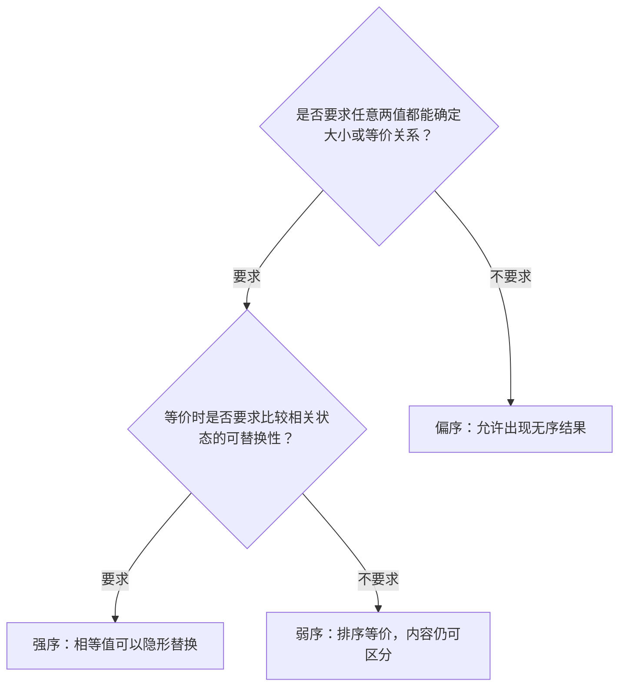

# string 的实现

## 字符类型与编码

前面使用的 `std::string`，是类模板 `std::basic_string` 以 `char` 作为字符类型时的别名。字符类型可以作为模板参数，字符串类也就能够适应不同的字符表示方式。这次我们先实现使用 `char` 存储数据的 `wind::string`，将主要精力放在存储管理和接口设计上。


字符需要经过编码，才能以字节序列存进内存。ASCII 使用 7 位编码，能够表示英语字母、数字和常见符号。随着需要表示的文字越来越多，Unicode 为不同文字中的字符分配了统一的码位；UTF-8 则是把这些码位编码为字节序列的一种方式。它采用变长编码，一个码位使用一到四个字节，常用汉字通常使用三个字节。


GBK 也是一种字符编码，和 UTF-8 使用不同的编码规则：


Windows 的一些历史环境中广泛使用过 GBK，Linux 环境通常使用 UTF-8。文本以一种编码保存，却按另一种编码读取，就可能出现乱码。源代码中的中文注释在不同环境之间传递时，也会遇到这个问题。

我们的字符串按 `char` 元素保存和处理数据。对于 UTF-8 文本，一个汉字可能占多个 `char`，所以长度、下标和后面的插入删除操作，针对的都是这些元素。我们先把这层存储与操作机制建立起来。

## 对象的存储结构

这次采用单个 `.hpp` 文件组织实现。后面实现容器时，会经常用到模板，把声明和实现放在一起也方便阅读。这里先介绍对象保存哪些状态，再逐步补充接口。

我们加入小字符串优化（Small String Optimization，SSO）：较短的字符串直接放进对象内部的固定缓冲区，较长的字符串才使用堆空间。这样，保存短字符串时就可以省去一次额外的空间申请。

实现中用到的主要头文件如下，后面的片段省略重复的头文件和类定义。当前实现使用 C++20：

```cpp
#include <algorithm>         // min、max、fill_n、swap
#include <boost/assert.hpp>  // Boost 断言
#include <compare>           // 三路比较结果
#include <concepts>          // 类型约束
#include <cstddef>           // size_t、ptrdiff_t
#include <cstdint>           // uintptr_t
#include <cstring>           // strlen、memcpy、memmove、memcmp
#include <initializer_list>  // initializer_list
#include <iomanip>           // setw
#include <ios>               // 流状态与格式标志
#include <istream>           // 输入流
#include <iterator>          // 输入迭代器约束
#include <locale>            // 字符分类
#include <limits>            // numeric_limits
#include <ostream>           // 输出流
#include <stdexcept>         // 标准异常类型
#include <string>            // 标准字符串示例
#include <string_view>       // 字符串视图
#include <utility>           // swap
#include <vector>            // KMP 前缀表
```

`<boost/assert.hpp>` 来自 Boost，需要环境中已经安装对应的头文件。Boost 是一组 C++ 库，提供容器、字符串处理、测试等许多工具；这里先用到它的断言功能。

### 静态常量与两种存储方式

我最初学习 C++ 时，接触较多的是 C++98 到 C++14，通常会在类内声明静态数据成员，再在类外定义。沿用这种组织方式，把定义放在头文件时，可以在 C++17 中加上 `inline`：

```cpp
namespace wind {
class string {
private:
    static std::size_t SSO_CAPACITY;
};

inline std::size_t string::SSO_CAPACITY = 15;
}
```

这里展示的是静态成员的组织方式。具体到我们的缓冲区容量，它是一个固定的编译期常量，直接写成 `static constexpr` 更合适；从 C++17 开始，这样的静态数据成员也隐式具有 `inline` 属性。有关类外定义和单一定义规则的讨论，可以接上前面“类和对象”中的静态成员部分。

接下来用联合体把缓冲区和堆指针放在同一片空间中：

```cpp
namespace wind {
class string {
public:
    using self = string;
    string() {}

private:
    static constexpr std::size_t SSO_CAPACITY = 15;

    union storage {
        // 额外留一个位置存放终止符
        char _buffer[SSO_CAPACITY + 1];
        char* _ptr;
    };

    // 先在声明处给出默认状态
    storage _storage{};
    size_t _size = 0;
    size_t _capacity = SSO_CAPACITY;

    // 根据容量判断当前使用哪种存储方式
    bool is_sso() const noexcept {
        return _capacity == SSO_CAPACITY;
    }
};
}
```

`_size` 记录有效字符数，`_capacity` 记录可容纳的有效字符数，终止符另外占一个位置。初始容量为 15，因此缓冲区实际有 16 个 `char`。初始长度为零，表示保存空字符串。

我们用 `_capacity` 判断存储模式：等于 `SSO_CAPACITY` 时使用 `_buffer`，更大时使用 `_ptr` 指向的堆空间。`is_sso()` 后面的 `const` 表示它不修改对象；`noexcept` 表示它承诺不向外传播异常。

### 补充：联合体中的对象由谁管理？

联合体的成员共享一片存储空间。`_storage{}` 使用空列表初始化，第一个成员 `_buffer` 的字符元素会被初始化为零。在当前环境中，缓冲区比指针大，因此从存储字节来看，与 `_ptr` 重叠的那部分空间也一起清零了。当前使用的成员仍是 `_buffer`，这里先按缓冲区来访问这片空间。

把 C++ 中的对象生命周期管理也牵扯进来，联合体就会比单纯共享空间复杂一些。假设其中一个成员是内置类型，另一个成员是具有非平凡构造、析构行为的类：同一片空间究竟正在保存哪个成员？切换时又应该构造、销毁哪个对象？

普通联合体不会自动追踪这些切换。程序需要记录当前使用的成员，并在切换时手动安排对象的构造和销毁。构造可以使用定位 `new`，C++20 也提供了 `std::construct_at`；销毁可以显式调用析构函数，也可以使用 C++17 引入的 `std::destroy_at`。

如果希望一个组件替我们记录当前类型并管理切换，可以了解标准库的 `std::variant`，它会保存相应的状态信息。我们这里使用字符数组和指针，通过 `_capacity` 就能判断存储模式，管理工作主要是迁移字符，以及在需要时释放堆空间。这一补充可以先跳过，后文会直接按这两种存储模式展开。

### 初始化对象

成员的初始化顺序取决于它们在类中的声明顺序，初始化列表也按这个顺序书写，比较容易看清过程。前面已经在声明处给出了默认值；为了示范初始化列表，无参构造函数也可以写成下面这样，用它替换前面的空函数体版本：

```cpp
// public:
    string() : _storage(storage()), _size(0), _capacity(string::SSO_CAPACITY) {}
```

之后的构造函数可以沿用成员默认值，或者通过委托构造先得到这个空字符串状态。在写接收字符数据的构造函数之前，我们先把空间管理接口准备好。

## 内存管理的三层接口

空间管理分为三层：底层负责申请、释放资源；中间层执行容量调整；上层决定什么时候调整，以及调整到多大。


如果把这三层接口比作一个微型社会，那么第一层就是基层劳动者，负责完成最基础、最具体的工作；第三层则是决策层，负责制定策略、发号施令，通常不亲自参与具体劳动。

至于第二层，颇有些中产阶层的味道：上面提出要求，下面提供能力，自己负责组织协调、严格落实。既要理解上层的意图，又要保证底层的执行结果符合预期。出了问题，还得先检查是不是自己落实得不到位。

看来，即便是在程序设计中，中间层也逃不过承上启下的命运。

### 申请和释放空间

底层的两个函数不依赖具体对象的状态，可以写成静态成员函数。申请空间时比容量多留一个字符，用于存放末尾的 `\0`：

```cpp
    // 申请指定容量的堆空间
    static char* allocate(size_t capacity) {
        return new char[capacity + 1];
    }

    // 释放堆空间
    static void deallocate(char* ptr) noexcept {
        delete[] ptr;
    }
```

把资源申请单独抽出来，也为以后更换空间管理方式留出了位置。上面的接口按“容量”提出要求，具体怎样取得和释放资源，则由这一层负责。当前直接使用 `new[]` 和 `delete[]`。

### 执行扩容：grow_capacity

中间层接收上层给出的目标容量，完成空间申请、字符迁移和状态更新：

```cpp
// 依据上层指示进行严格扩容
    void grow_capacity(size_t new_capacity) {
        BOOST_ASSERT_MSG(
            new_capacity > _capacity,
            "This function requires a capacity greater than the current capacity.");  // 此函数在设计上不负责缩小容量
        BOOST_ASSERT_MSG(
            new_capacity <= max_capacity,
            "This function does not perform capacity overflow checks.");  // 此函数在设计上不负责容量溢出检查

        char* new_ptr = allocate(new_capacity);

        std::memcpy(new_ptr, data(), _size + 1);

        if (!is_sso()) deallocate(_storage._ptr);

        _storage._ptr = new_ptr;
        _capacity = new_capacity;
    }
```

这里先出现了两个断言。`BOOST_ASSERT_MSG` 来自 Boost.Assert，除了检查条件，还可以附带一条说明。用标准库的 `assert` 也可以表达相同的要求：

```cpp
#include <cassert>

assert(new_capacity > _capacity &&
       "This function requires a capacity greater than the current capacity."); // 此函数在设计上不负责缩小容量

assert(new_capacity <= max_capacity &&
       "This function does not perform capacity overflow checks."); // 此函数在设计上不负责容量溢出检查
       
// 利用 && 的短路求值机制附带自定义错误信息：
// 条件成立时，整个表达式为 true，断言通过；
// 条件不成立时，整个表达式为 false，断言失败，
// 错误信息字符串会作为断言表达式的一部分显示在诊断信息中。
```

为什么要在这里检查？因为这个私有函数在设计上只负责执行扩容策略，上层应该先把目标容量计算好。但上层也是我们自己写的，写错调用参数并不稀奇。把接口要求写成断言，就能让调试过程替我们检查这种内部约定。

例如，当前容量是 64，上层却把 32 交给 `grow_capacity`。如果中间层直接照办，就会执行一次缩小空间的操作，甚至可能把原有字符复制到放不下它们的新空间里。第一个断言会在进入实际操作前发现这个问题，让我们回头检查上层的容量计算。

即使新容量仍能装下现有字符，我们也要求它大于原容量。这个函数的职责就是扩容；缩容可能涉及从堆空间回迁到 SSO 缓冲区，需要另一套处理逻辑，交给后面的接口负责。这样每层代码需要处理的状态更少，也更容易核对。

第二个断言是 ChatGPT 提出的补充：底层申请的是 `new_capacity + 1` 个字符，要为终止符留位置。如果传入的容量太大，加一就可能溢出。因此我们把可接受的上限写成静态成员 `max_capacity`，供多个接口共同使用。

这些断言检查的是内部调用是否符合约定。采用通过 `NDEBUG` 关闭断言的配置后，相应检查不再执行；面向外部调用者的参数检查，仍由上层公开接口处理。


对象的最小容量是 `SSO_CAPACITY`，严格扩容后的容量一定更大，因此这个接口取得的新空间一定采用堆存储。

申请成功后，把原字符连同终止符复制到新空间。此时 `_capacity` 还没有改变，`is_sso()` 仍能判断原来的存储模式：原来使用堆空间才需要释放，使用对象内部缓冲区时则不释放。最后保存新指针，更新容量。

这个过程中使用的 `data()` 根据当前模式返回字符序列的首地址：

```cpp
public:
    char* data() noexcept {
        return is_sso() ? _storage._buffer : _storage._ptr;
    }
```

### 执行缩容：shrink_capacity

缩容同样只接收目标容量，具体是否需要缩容，由上层判断：

```cpp
 // 依据上层指示进行严格缩容
    void shrink_capacity(size_t target_capacity) {
        BOOST_ASSERT_MSG(!is_sso(), "This function requires heap storage.");

        BOOST_ASSERT_MSG(target_capacity < _capacity,
                         "This function requires a capacity smaller than the current capacity.");

        BOOST_ASSERT_MSG(target_capacity >= _size,
                         "This function does not support shrinking that causes data loss.");

        if (target_capacity <= SSO_CAPACITY) {
            char* old_ptr = _storage._ptr;

            std::memcpy(_storage._buffer, old_ptr, _size + 1);

            deallocate(old_ptr);
            _capacity = SSO_CAPACITY;
            return;
        }

        char* new_ptr = allocate(target_capacity);

        std::memcpy(new_ptr, _storage._ptr, _size + 1);

        deallocate(_storage._ptr);

        _storage._ptr = new_ptr;
        _capacity = target_capacity;
    }
```

三个断言分别检查：当前使用堆空间、目标容量小于原容量，以及目标容量仍能容纳全部有效字符。

当目标容量不大于 `SSO_CAPACITY` 时，字符就能搬回对象内部的缓冲区。这里要先保存 `_storage._ptr`，因为指针和缓冲区共用联合体的空间，写入缓冲区会覆盖指针原来的内容。等字符连同终止符复制完成，再用保存下来的旧指针释放堆空间，并把容量恢复为 SSO 容量。

目标容量仍大于 SSO 容量时，继续使用堆存储：申请一块较小的空间，复制字符，释放旧空间，最后更新指针和容量。

### 决定扩容策略：reserve

上层的 `reserve` 接收调用者希望达到的最小容量。它负责判断请求是否合理，并决定实际申请多大：

```cpp
  void reserve(size_t min_capacity) {
        if (min_capacity <= _capacity) return;

        if (min_capacity > max_capacity) throw std::length_error("string capacity overflow");

        // 按 1.5 倍计算，避免整数溢出
        size_t increment = _capacity / 2;

        size_t new_capacity =
            _capacity > max_capacity - increment ? max_capacity : _capacity + increment;

        new_capacity = std::max(new_capacity, min_capacity);

        grow_capacity(new_capacity);
    }
```

容量已经够用时直接返回。需要扩容时，先检查请求是否超过上限，再按当前容量的约 1.5 倍计算候选容量。单纯按 1.5 倍增长不一定能满足本次请求，因此还要取候选值和 `min_capacity` 中较大的一个。

表达式 `_capacity > max_capacity - increment` 在真正做加法之前检查是否会超过上限。这样就不会先让无符号整数溢出，再试图用已经回绕的结果判断大小。确定目标后，交给 `grow_capacity` 执行。

这里用 `throw` 抛出 `std::length_error`，表示无法满足这个长度请求。异常处理机制后面再展开，现在先理解为向调用者报告失败。

### 决定缩容时机：shrink_to_fit

`shrink_to_fit` 尝试让容量贴近当前长度。已经使用 SSO 时，缓冲区本来就固定在对象内部；容量等于长度时也没有继续缩小的必要。这两种情况直接返回，其余情况把当前长度交给缩容接口：

```cpp
 void shrink_to_fit() {
        if (is_sso()) return;

        if (_capacity == _size) return;

        shrink_capacity(_size);
    }
```

## 追加字符与处理自引用

### 先实现 C 风格字符串追加

有了容量管理，`append(const char*)` 的主线就很清楚：取得源字符串长度，保证容量足够，把字符复制到末尾，更新长度并补上终止符。

不过，源字符串也可能来自当前对象，例如把自己的内容再追加一遍，或者追加自己的一段后缀。我们把这种情况称为自引用。如果扩容更换了空间，原来的源指针就可能失效，必须在扩容前记下它相对于首字符的偏移量：

```cpp
self& append(const char* str) {
        // 将指针转换为无符号整数，通过地址区间判断是否存在自引用
        const auto begin_addr = reinterpret_cast<std::uintptr_t>(data());
        const auto source_addr = reinterpret_cast<std::uintptr_t>(str);

        const bool self_reference = source_addr >= begin_addr && source_addr - begin_addr <= _size;

        // 如果存在自引用，提前记录源字符串相对于当前字符串的偏移量
        // 避免扩容后原始指针失效，导致无法重新定位源字符串
        const size_t offset = self_reference ? static_cast<size_t>(source_addr - begin_addr) : 0;

        const size_t len = std::strlen(str);

        if (len > max_capacity - _size) throw std::length_error("string capacity overflow");

        // 根据追加后的长度决定是否扩容
        reserve(_size + len);

        // 自引用时，通过偏移量重新定位源字符串
        // 普通情况下，继续使用原始指针
        const char* source = self_reference ? data() + offset : str;

        // 只复制有效字符，不复制原字符串的结束符
        // 这样即使存在自引用，源区域与目标区域也不会发生重叠
        std::memcpy(data() + _size, source, len);

        // 更新字符串长度，并统一补充结束符
        _size += len;
        data()[_size] = '\0';

        return *this;
    }
```


`self_reference` 先检查源地址是否不小于起始地址，再检查两者的距离是否不超过 `_size`。满足条件时，源数据来自当前保存的字符区域，我们就记录偏移量。扩容之后，无论首地址怎样变化，都可以用新的 `data()` 加上原偏移量重新找到源字符。

这个版本使用 `strlen` 确定长度，只复制终止符之前的字符。自引用源区域位于原字符区间，目标从原来的 `_size` 处开始，两段有效字符不会重叠，所以这里使用 `memcpy`。复制后统一补上终止符，并返回当前对象的引用，供后面的链式调用和运算符重载复用。`self` 是开头为当前类定义的类型别名。

### 补充：这里为什么用了两种类型转换？

写这部分时，我最初想直接比较指针，判断源地址是否落在对象自己的存储区间。ChatGPT 纠结的是：如果传入指针来自另一个对象，不同对象的指针使用大小比较，能否按我们想要的实际地址顺序工作？最后我们在当前环境中将指针转换为 `std::uintptr_t`，再比较地址数值，保留这种区间判断思路。这依赖当前实现中整数地址的顺序能够满足所需的区间判断。

C 风格的强制转换写成 `(目标类型)表达式`，同一种写法可能承担不同性质的转换。C++ 提供了几种有明确适用范围的转换运算符，让代码能直接表达要做哪类转换。这里先认识用到的两种。

`static_cast` 适合语言规则中有明确定义的一些转换，例如把整数转换成另一种整数类型。代码先算出地址差，再将这个整数转成 `size_t`，用的就是它。

`reinterpret_cast` 用于指针与整数之间、不同指针类型之间等较底层的转换。在这里，它把指针转换为足以容纳它的整数类型 `std::uintptr_t`，方便后续进行整数运算。它没有复制字符数据，也没有把字符内容转换成数字，转换的是指针所表示的地址信息。

从指针到整数的具体映射由实现决定。我们的这段代码按当前运行环境的地址表示方式进行区间判断；后续有关自引用的接口沿用同一方法。

### 复用追加操作完成构造

接收 C 风格字符串的构造函数，可以先取得一个空字符串状态，再调用 `append`。这样，空间申请、字符复制和终止符维护就不用重新写一遍：


## 清理内容与释放存储

清理可以从两个角度考虑：不再保存当前字符，或者连额外申请的空间也一起释放。把它们拆开，调用时就能根据需求选择。

### 清空内容，复用容量

`clear_content` 只清空内容：

```cpp
// 清空字符串内容，保留现有存储空间
    void clear_content() noexcept {
        _size = 0;
        data()[0] = '\0';
    }
```

长度改为零，再把首字符设为终止符，对象就表示空字符串了。后面的字符不需要逐个擦除，因为它们已经不属于有效字符区间。

保留额外存储是为了复用。例如对象刚保存过一个较长的字符串，现在要换成另一个长度相近的字符串，可以先清空，再追加。只要原容量足够，就不必先释放空间又重新申请。

这里说“额外存储”，当前指的就是堆空间。底层已经把 `allocate`、`deallocate` 单独抽了出来，以后更换资源申请方式时，上层仍可以保留“清空内容”和“释放存储”的区分。

### 释放资源，回到初始状态

`release_storage` 则释放可能存在的堆空间，让对象重新保存一个空的 SSO 字符串：

```cpp
// 释放额外存储空间，并恢复对象的初始状态
    // 一个主要用途是给析构做清理调用
    // 我们称之为"怎么来的, 就怎么走"
    void release_storage() noexcept {
        if (!is_sso()) deallocate(_storage._ptr);

        _storage._buffer[0] = '\0';
        _size = 0;
        _capacity = SSO_CAPACITY;
    }
```

它先根据原模式决定是否释放空间，再恢复缓冲区、长度和容量。对象重新回到无参构造后的状态，颇有点“怎么来的，就怎么走”的意思。这也是资源管理中常见的思路。

对应的公开接口和析构函数如下：

```cpp
void clear() {
        clear_content();
    }

    void reset_storage(){
        release_storage();
    }
    
 ~string() {
        release_storage();
    }
```

`clear()` 保留容量，`reset_storage()` 进一步释放额外存储，析构函数则复用资源释放逻辑。长度和容量的查询接口直接返回相应成员：


## 元素访问与迭代器

### 下标访问与 at

下标访问返回字符的引用，因而既可以读，也可以修改。为了让普通对象和常对象都能使用，需要提供两个重载：


普通对象返回可修改的字符引用，常对象返回常引用。相应地，`data()` 也增加返回 `const char*` 的常成员函数版本。

图中的下标访问使用断言帮助调试，关闭断言后便不再执行该检查。`at()` 则在调用时检查位置，越界时抛出异常，然后复用下标访问：


### 用字符指针表示迭代器

前面使用标准库时，我们通过 `begin()`、`end()` 取得迭代器，解引用访问元素，用 `++` 向后移动。现在自己实现，就需要决定用什么表示字符的位置。

我们的字符连续存放，指针已经支持解引用、递增和比较。因此，普通迭代器直接定义为 `char*`，常量迭代器定义为 `const char*`，就具备了遍历需要的操作，也省去了再写一层包装和运算符重载。

`begin()` 返回 `data()`，指向首字符；`end()` 返回 `data() + _size`，表示最后一个有效字符之后的位置，也就是当前终止符的位置。遍历区间是 `[begin(), end())`，终止符不作为有效字符参与遍历。空字符串的首尾迭代器相等，自然不会进入循环。

无论底层使用 SSO 还是堆空间，`data()` 都能返回当前字符区间的起点，所以两种存储方式共用这套接口：


常对象的 `begin()`、`end()` 返回常量迭代器；`cbegin()`、`cend()` 则明确表达只读遍历的意图。反向迭代器留待后续实现。

## 扩充追加接口

### npos 与容量上限

后面的接口经常需要一个特殊值，表示“没有找到”或者“取到剩余内容末尾”，这就是 `npos`。

前面为了取得 `size_t` 的最大值，还专门请出了 `std::numeric_limits`；换个角度，`-1` 转换为无符号类型就能得到该类型的最大值，`-2` 则对应倒数第二个值。最大值留给 `npos`，容量上限再空出终止符的位置：


`npos` 是公开接口的一部分，应放在 `public` 中；`max_capacity` 和 `SSO_CAPACITY` 属于内部实现，放在 `private` 中。上图中 `npos` 的访问区域需要据此调整。

### 追加指定长度的字符数组

接收明确长度后，源数据就不必是以 `\0` 结尾的 C 风格字符串，也可以在中间包含 `\0`。所以这个重载以 `n` 为长度依据，不使用 `strlen`：

```cpp
// 从字符数组中追加 n 个字符，允许包含 '\0'
    self& append(const char* chars, size_t n) {
        if (n == 0) return *this;

        // 检查追加后的容量是否溢出
        if (n > max_capacity - _size) throw std::length_error("string capacity overflow");

        // 判断源地址是否位于当前字符串的有效存储范围内
        const auto begin_addr = reinterpret_cast<std::uintptr_t>(data());
        const auto end_addr = reinterpret_cast<std::uintptr_t>(data() + _size);
        const auto source_addr = reinterpret_cast<std::uintptr_t>(chars);

        const bool self_reference = source_addr >= begin_addr && source_addr <= end_addr;

        // 如果存在自引用，记录源地址相对于当前字符串的偏移量
        const size_t offset = self_reference ? static_cast<size_t>(source_addr - begin_addr) : 0;

        // 根据追加后的字符数量决定是否扩容
        reserve(_size + n);

        // 扩容可能导致原地址失效，因此需要重新定位自引用源地址
        const char* source = self_reference ? data() + offset : chars;

        // 复制指定数量的字符，允许源区域与目标区域重叠
        std::memmove(data() + _size, source, n);

        // 更新长度，统一补充字符串结束符
        _size += n;
        data()[_size] = '\0';

        return *this;
    }
```

整体思路沿用前面的自引用处理：先保存偏移量，再扩容，之后重新定位源字符。复制时使用 `memmove`，允许源区域与目标区域重叠。最后仍然统一补上自己的终止符。

明确长度的版本更基础，之前的 `append(const char*)` 只要先取得长度，就能转而复用它。下面的短版本替换前面用于推导过程的完整版本；接收另一个字符串对象的重载，也统一交给它：

```cpp
 self& append(const char* str) {
        return append(str, std::strlen(str));
    }

    // 从另一个 string 的指定位置开始，追加最多 sublen 个字符
    self& append(const self& str, size_t subpos, size_t sublen = npos) {
        // 起始位置不能超过源字符串长度
        if (subpos > str._size) throw std::out_of_range("string::append: subpos out of range");

        // 根据剩余字符数量确定实际追加长度
        const size_t len = std::min(sublen, str._size - subpos);

        // 复用字符数组追加接口
        return append(str.data() + subpos, len);
    }

    // 追加另一个 string 的全部内容
    self& append(const self& str) {
        return append(str, 0);
    }
```

子串版本先检查 `subpos`，再用源字符串的剩余长度限制本次追加量。这样，默认传入 `npos` 就表示追加剩余全部字符；接收整个对象的重载再复用子串版本。源对象也可以是当前对象自身，底层字符数组接口已经处理了自引用。

### 追加多个相同字符

数量和字符版本不需要考虑源地址，保证容量后直接填充：

```cpp
// 在字符串末尾追加 n 个字符 c
    self& append(size_t n, char c) {
        if (n == 0) return *this;

        // 检查追加后的容量是否溢出
        if (n > max_capacity - _size) throw std::length_error("string capacity overflow");

        // 确保具有足够的存储空间
        reserve(_size + n);

        // 将 n 个字符 c 填充到字符串末尾
        std::fill_n(data() + _size, n, c);

        // 更新长度，并补充字符串结束符
        _size += n;
        data()[_size] = '\0';

        return *this;
    }
```

这里使用 `std::fill_n`。它按元素赋值，`memset` 则按字节填充。对于 `char`，两者看上去很接近；换成多字节类型时，按字节重复某个数值和给每个元素赋同一个值，结果就可能不同。

`fill_n` 怎样适应元素大小？它把第一个参数当作迭代器，逐个解引用、赋值、递增。`char*` 递增后指向下一个字符，`int*` 递增后指向下一个整数，元素大小由迭代器的操作自然体现，不需要算法自己计算每个元素占多少字节。

### 从迭代器区间追加

如果迭代器来自当前对象，扩容可能使它失效。可以先用区间构造一个独立字符串，再追加这个临时对象：

```cpp
// 追加迭代器区间中的字符
    template <class InputIterator>
    self& append(InputIterator first, InputIterator last) {
        // 先构造独立的临时字符串，避免自引用时迭代器失效
        self temp(first, last);

        // 复用已有的字符串追加接口
        return append(temp);
    }
```

这里接收的是通用输入迭代器，来源未必是我们的字符串，底层也未必是指针。它不一定支持减法或与 `data()` 计算偏移量，所以不能直接照搬字符指针的处理。先保存区间中的字符，就能统一处理这些来源。

不过，无约束的模板还存在一个问题：两个参数类型相同，并不能保证它们是迭代器。假设类中还提供了 `string(size_t n, char c)`，表示构造 `n` 个字符 `c`，现在写 `string s(5, 65)`。这里的 65 本意是 ASCII 码 65，即大写字母 `A`，我们想得到五个 `A`。

对编译器来说，5 和 65 都是 `int`。无约束的区间构造模板可以把它们精确匹配为同一种类型；数量和字符版本却需要转换参数，因此模板可能被选中，随后在把整数当作迭代器使用时出错。

### 用概念与约束表达模板要求

C++20 的概念（Concepts）与约束，让我们可以在模板入口直接描述类型需要具备的能力。限制不必只是“必须属于某一种具体类型”，还可以表达能否解引用、能否递增、能否转换为另一种类型，并组合多个条件。模板仍然允许多种类型使用，但这些类型要符合当前操作的要求。

对于区间构造，我们需要读取 `*first`，执行 `++first`，并判断是否到达末尾。标准库的 `std::input_iterator` 概念描述了输入迭代器的要求，定义在 `<iterator>` 中。把它写进约束，整数类型就无法作为这个区间接口的迭代器参数，前面的调用可以转而选择数量和字符版本。

下面分别展示 `requires` 和受约束的模板参数两种写法，用它们替换无约束版本：

```cpp
// 迭代器区间构造
    template <class InputIterator>
        requires std::input_iterator<InputIterator>
    string(InputIterator first, InputIterator last) : string() {
        for (; first != last; ++first) append(1, *first);
    }


 // 追加迭代器区间中的字符
    template <std::input_iterator InputIterator>
    self& append(InputIterator first, InputIterator last) {
        // 先构造独立的临时字符串，避免自引用时迭代器失效
        self temp(first, last);

        // 复用已有的字符串追加接口
        return append(temp);
    }
```

`requires std::input_iterator<InputIterator>` 将要求写在模板参数列表之后；`template <std::input_iterator InputIterator>` 则直接在参数处指定概念。两种写法在这里表达相同的限制。后面为字符串视图提供接口时，我们还会用多个条件描述匹配范围。

### 接收列表中的字符

接下来让 `append` 支持列表初始化形式的调用。参数使用 C++11 引入的 `std::initializer_list<char>`：

```cpp
#include <initializer_list>

// 追加初始化列表中的所有字符
self& append(std::initializer_list<char> il) {
    return append(il.begin(), il.size());
}
```

例如：

```
s.append({'H', 'e', 'l', 'l', 'o'});
```

可以把 `std::initializer_list` 理解为一种轻量级的只读访问适配器。它通过 `begin()`、`end()` 和 `size()` 提供对底层数组的访问，字符数据存储在数组中。

初始化这个 `std::initializer_list<char>` 时，编译器会创建一个匿名常量数组，保存列表中的五个字符，再让参数对象提供对它的访问。`initializer_list` 本身没有把五个字符作为自己的元素存储起来。

这个匿名数组具有临时对象的生命周期。用它初始化 `initializer_list` 时，生命周期延长的规则与临时对象绑定到引用的规则类似；`initializer_list` 本身是一个类类型。在当前调用中，匿名数组在整个调用期间有效，因此 `append` 可以读取其中的字符。

数组不需要以 `\0` 结尾，所以接口直接传递首地址和元素数量，复用 `append(const char*, size_t)`。这也体现出统一补终止符的好处：源数据只负责提供指定数量的字符，目标字符串负责在自己的有效字符之后维护终止符。

### 使用字符串视图

前面的列表参数借助编译器创建的数组提供字符。如果数据已经存在，我们能否直接描述其中的一段，省去额外的字符复制？

C++17 引入的 `std::string_view`（字符串视图）提供了这种能力。它通常保存首地址和长度，描述一段连续的字符数据，不拥有底层字符。例如：

```
std::string str = "Hello World";
std::string_view sv(str.data() + 6, 5);
```

`sv` 描述原字符串中的 `"World"`，没有复制这五个字符。底层数据仍由 `str` 管理，如果 `str` 被销毁，或者重新分配空间，原视图就可能失效。

字符串视图以长度确定范围，既不要求末尾有 `\0`，也允许中间包含 `\0`。因此，取得视图的首地址和长度，就能复用已经实现的字符数组追加接口。

标准库在 C++17 中为 `append` 增加了相应的模板重载。我们用当前的 C++20 约束写法，实现追加整个视图和追加部分视图两种形式：

```cpp
#include <concepts>
#include <string_view>

// 追加能够转换为字符串视图的字符序列
template <class StringViewLike>
    requires (
        std::convertible_to<const StringViewLike&, std::string_view> &&
        !std::convertible_to<const StringViewLike&, const char*>
    )
self& append(const StringViewLike& t) {
    std::string_view view = t;
    return append(view.data(), view.size());
}

// 追加字符串视图中指定位置开始的部分字符
template <class StringViewLike>
    requires (
        std::convertible_to<const StringViewLike&, std::string_view> &&
        !std::convertible_to<const StringViewLike&, const char*>
    )
self& append(const StringViewLike& t, size_t pos, size_t count = npos) {
    std::string_view view = t;
    std::string_view subview = view.substr(pos, count);
    return append(subview.data(), subview.size());
}
```

这里的 `std::convertible_to` 定义在 `<concepts>` 中，用来检查类型之间是否满足相应的转换要求。约束分成两个条件：

```
std::convertible_to<const StringViewLike&, std::string_view>
```

这个条件要求参数能够转换为 `std::string_view`。`const StringViewLike&` 对应函数实际接收的参数类型；目标类型写 `std::string_view` 即可，视图本来就提供对底层字符的只读访问。

```
!std::convertible_to<const StringViewLike&, const char*>
```

第二个条件排除能够转换成 `const char*` 的类型，让 C 风格字符串继续走原有重载。两个条件用 `&&` 连接，只有同时满足，模板才参与相应的重载匹配。

第一个实现直接提取首地址和长度。第二个先调用视图的 `substr()` 取得子视图：它只改变所描述的范围，不复制字符；起点超过视图长度时抛出 `std::out_of_range`，请求数量超过剩余长度时则取实际剩余部分。最终两者都复用已有追加逻辑，自引用、容量调整和终止符维护也随之复用。

### 复用 append 实现 push_back 和 +=

`push_back(char)` 就是追加一个字符：

```cpp
void push_back(char c) {
    append(1, c);
}
```

四个 `operator+=` 也分别转发给对应的 `append`。前面让 `append` 返回当前对象引用，到这里就能直接沿用：

```cpp
// 追加另一个 string 对象
    self& operator+=(const self& str) {
        return append(str);
    }

    // 追加 C 风格字符串
    self& operator+=(const char* str) {
        return append(str);
    }

    // 追加单个字符
    self& operator+=(char c) {
        return append(1, c);
    }

    // 追加初始化列表中的字符
    self& operator+=(std::initializer_list<char> il) {
        return append(il);
    }
```

## 拷贝构造、交换与赋值

### 拷贝构造

拷贝构造先通过委托构造取得干净的空字符串状态，再准备容量、复制字符并更新长度：

```cpp
string(const self& obj) : string() {
    reserve(obj._size);
    _size = obj._size;
    std::memcpy(data(), obj.data(), obj._size);
    data()[_size] = '\0';
}
```

只复制对方的有效字符，最后仍统一写终止符。双方各自管理自己的存储，对其中一个对象的后续修改不会改变另一个对象。

### 交换对象状态

`swap` 直接交换存储、长度和容量：

```cpp
 void swap(self& obj) noexcept {
        std::swap(_storage, obj._storage);
        std::swap(_size, obj._size);
        std::swap(_capacity, obj._capacity);
    }
```

联合体在这里就比较省事了。SSO 模式交换固定大小的缓冲区，堆模式交换指向堆空间的指针内容。随后再交换长度和容量，字符数据与描述它的状态就一起转到了对方对象上。我们通过容量解释联合体，两者一起交换后，存储模式也保持对应。

### 拷贝赋值与异常保证

赋值时，对象已经可能保存了一份内容，所以还要考虑原有资源怎样处理：

```cpp
self& operator=(const self& obj) {
        // 避免自赋值
        if (this == &obj) return *this;

        clear_content();

        //  确保容量充足，避免扩容时复制即将被覆盖的旧内容
        reserve(obj._size);

        // 复制有效字符
        std::memcpy(data(), obj.data(), obj._size);

        // 更新长度，统一补充终止符
        _size = obj._size;
        data()[_size] = '\0';

        return *this;
    }
```

先检查是否自赋值。遇到 `s = s`，直接保留当前状态即可。其他情况先清空旧内容，再保证容量足够，复制新字符，更新长度和终止符。

提前清空有一个考虑：如果本次需要扩容，旧字符反正要被覆盖，就不用在扩容时把整段旧内容再搬一次。不过，如果空间申请失败并抛出异常，原内容已经被清空，对象虽然还能正常使用，原数据却不再保留。这对应基本异常安全保证。

如果希望失败时原内容也不变，可以去掉 `clear_content()`。`reserve` 先申请新空间，成功后才释放旧空间；申请失败时原状态保持不变。之后的字符复制和成员更新不会抛出异常，因此这种写法可以提供强异常安全保证。代价是扩容过程中会先搬运旧内容，即使它随后会被覆盖。

还有两种复用现有接口的写法：先拷贝一个临时对象，再交换；或者直接按值接收参数，让参数成为那个副本：

```cpp
self& operator=(const self& obj) {
    self temp(obj);
    swap(temp);
    return *this;
}

// 通过按值传参构造副本，再交换资源
self& operator=(self obj) {
    swap(obj);
    return *this;
}
```

临时副本先取得新资源，构造成功后才交换。交换完成，旧资源交给临时对象或形参，在它销毁时释放。上面的几种赋值写法选择一种即可，同时保留会让调用发生歧义。

## 插入与自引用

### 插入指定长度的字符数组

追加只是在末尾写字符，插入还要先把插入位置之后的字符向右移动。自引用时，源区间可能跟着移动，也可能被插入位置分成两段，需要分别找到移动后的源字符：


```cpp
self& insert(size_t pos, const char* chars, size_t n) {
        // 检查插入位置
        if (pos > _size) throw std::out_of_range("string::insert: pos out of range");

        if (n == 0) return *this;

        // 检查插入后的容量是否溢出
        if (n > max_capacity - _size) throw std::length_error("string capacity overflow");

        // 通过地址区间判断是否存在自引用
        const auto begin_addr = reinterpret_cast<std::uintptr_t>(data());
        const auto source_addr = reinterpret_cast<std::uintptr_t>(chars);

        const bool self_reference = source_addr >= begin_addr && source_addr - begin_addr <= _size;

        // 如果存在自引用，记录源地址相对于当前字符串的偏移量
        const size_t offset = self_reference ? static_cast<size_t>(source_addr - begin_addr) : 0;

        // 确保具有足够的容量
        reserve(_size + n);

        // 将插入位置之后的有效字符整体右移
        std::memmove(data() + pos + n, data() + pos, _size - pos);

        // 利用两个视图描述需要复制的字符区域
        std::string_view a{};
        std::string_view b{};

        if (!self_reference) {
            // 外部字符数组，直接使用原始数据
            a = std::string_view(chars, n);
        } else if (offset + n <= pos) {
            // 源区域完全位于插入位置之前，不受尾部移动影响
            a = std::string_view(data() + offset, n);
        } else if (offset >= pos) {
            // 源区域整体向右移动了 n 个位置
            a = std::string_view(data() + offset + n, n);
        } else {
            // 插入位置将原来的源区域分成两段
            const size_t first_len = pos - offset;

            a = std::string_view(data() + offset, first_len);
            b = std::string_view(data() + pos + n, n - first_len);
        }

        // 将源字符复制到插入位置
        std::memcpy(data() + pos, a.data(), a.size());

        if (!b.empty()) std::memcpy(data() + pos + a.size(), b.data(), b.size());

        // 更新字符串长度，并统一添加终止符
        _size += n;
        data()[_size] = '\0';

        return *this;
    }
```

检查位置和容量之后，仍先记录自引用偏移量，再扩容。尾部移动用 `memmove`，因为移动前后的区间可能重叠。终止符最后统一补，所以这里先搬有效字符。

字符移动后，可以按源区间与插入位置的关系确定来源：源区间完全在插入位置之前，位置不变；整个源区间位于插入位置及其之后，就整体右移 `n`；插入位置落在源区间内部时，前半段位置不变，后半段右移。代码用 `a`、`b` 两个字符串视图描述这些区间，再把字符复制到空出的插入位置。

外部字符数组没有跟随当前对象移动，直接用原指针建立视图即可。写入完成后，增加长度，补上终止符。

### 其他插入重载

接收整个字符串、子串、C 风格字符串和字符串视图的版本，都可以转换成首地址加长度，复用刚才的接口。重复字符版本则直接填充插入区间：

```cpp
self& insert(size_t pos, const self& str) {
        return insert(pos, str.data(), str.size());
    }

    self& insert(size_t pos, const self& str, size_t subpos, size_t sublen = npos) {
        // 检查子串开始位置
        if (subpos > str._size) throw std::out_of_range("string::insert: subpos out of range");

        // 根据剩余字符数量确定实际插入长度
        const size_t len = std::min(sublen, str._size - subpos);

        return insert(pos, str.data() + subpos, len);
    }

    self& insert(size_t pos, const char* str) {
        return insert(pos, str, std::strlen(str));
    }

    self& insert(size_t pos, size_t n, char c) {
        // 检查插入位置
        if (pos > _size) throw std::out_of_range("string::insert: pos out of range");

        if (n == 0) return *this;

        // 检查插入后的容量是否溢出
        if (n > max_capacity - _size) throw std::length_error("string capacity overflow");

        reserve(_size + n);

        // 将插入位置之后的有效字符整体右移
        std::memmove(data() + pos + n, data() + pos, _size - pos);

        // 将 n 个字符 c 填充到插入起始位置
        std::fill_n(data() + pos, n, c);

        _size += n;
        data()[_size] = '\0';

        return *this;
    }
    
 // 插入整个字符串视图
    template <class StringViewLike>
        requires(std::convertible_to<const StringViewLike&, std::string_view> &&
                 !std::convertible_to<const StringViewLike&, const char*>)
    self& insert(size_t pos, const StringViewLike& t) {
        std::string_view view = t;
        return insert(pos, view.data(), view.size());
    }

    // 插入字符串视图中的指定部分
    template <class StringViewLike>
        requires(std::convertible_to<const StringViewLike&, std::string_view> &&
                 !std::convertible_to<const StringViewLike&, const char*>)
    self& insert(size_t pos, const StringViewLike& t, size_t subpos, size_t sublen = npos) {
        std::string_view view = t;
        std::string_view subview = view.substr(subpos, sublen);

        return insert(pos, subview.data(), subview.size());
    }
```

### 使用迭代器指定位置

迭代器版本先把插入位置保存为偏移量。因为插入过程中可能扩容，操作结束后再用新的 `data()` 恢复这个逻辑位置：

```cpp
iterator insert(const_iterator p, size_t n, char c) {
        size_t pos = static_cast<size_t>(p - cbegin());

        insert(pos, n, c);

        return data() + pos;
    }

    iterator insert(const_iterator p, char c) {
        return insert(p, 1, c);
    }

    template <std::input_iterator InputIterator>
    iterator insert(const_iterator p, InputIterator first, InputIterator last) {
        size_t pos = static_cast<size_t>(p - cbegin());
        string tmp(first, last);
        insert(pos, tmp);
        return data() + pos;
    }

    iterator insert(const_iterator p, std::initializer_list<char> il) {
        size_t pos = static_cast<size_t>(p - cbegin());
        insert(pos, il.begin(), il.size());
        return data() + pos;
    }
```

返回值指向插入后的第一个新字符，调用者可以用它继续访问相同逻辑位置。区间来源使用通用输入迭代器时，仍先构造临时字符串，保存源字符，再进行实际插入。

## 删除与调整长度

### 删除字符

删除的主要工作是把删除区间之后的有效字符向前移动，再调整长度：

```cpp
 // 从指定位置开始，删除最多 count 个字符
    self& erase(size_t pos = 0, size_t count = npos) {
        // 检查删除位置
        if (pos > _size) throw std::out_of_range("string::erase: pos out of range");

        // 确定实际删除的字符数量
        size_t len = std::min(count, _size - pos);

        // 将删除区间之后的有效字符向前移动
        std::memmove(data() + pos, data() + pos + len, _size - pos - len);

        // 更新长度，统一补充终止符
        _size -= len;
        data()[_size] = '\0';

        return *this;
    }

    // 删除迭代器指向的单个字符
    iterator erase(const_iterator p) {
        size_t pos = static_cast<size_t>(p - cbegin());

        erase(pos, 1);

        return data() + pos;
    }

    // 删除指定迭代器区间内的字符
    iterator erase(const_iterator first, const_iterator last) {
        size_t pos = static_cast<size_t>(first - cbegin());
        size_t len = static_cast<size_t>(last - first);

        erase(pos, len);

        return data() + pos;
    }
```

`count` 可以大于剩余字符数，所以先用 `min` 取得实际删除量。`memmove` 处理移动时的区间重叠，最后补终止符。这里没有释放存储空间，原容量可以继续使用。

迭代器重载把位置转成偏移量，复用下标版本，再返回删除后该位置的迭代器。它指向原删除区间之后的第一个字符；删到末尾时，返回 `end()`。

### 调整长度

`resize` 先保证容量。如果新长度更大，就填充新增字符；新长度更小时，循环不会执行，直接调整终止符和长度即可：

```cpp
void resize(size_t n, char c = '\0') {
        reserve(n);
        for (size_t i = _size; i < n; i++) {
            data()[i] = c;
        }
        data()[n] = '\0';
        _size = n;
    }
```

长度增加时，默认填充字符是 `\0`。这些字符属于有效字符区间，末尾还会另外维护一个终止符，因此字符串的逻辑长度仍然是 `n`。这也再次体现出按长度管理字符序列与依赖 `strlen` 读取 C 风格字符串的区别。

## 查找与子串

### 查找字符序列

这里保留朴素匹配和 KMP 两种方法，公开的 `find` 重载使用朴素匹配。我们主要看接口怎样组织，KMP 的推导可以参考之前的 [KMP 文章](https://blog.csdn.net/venti0411/article/details/166736100?spm=1011.2415.3001.5331)。

朴素匹配逐个尝试起点，比较当前位置开始的 `n` 个字符。起点越界或剩余长度不足时返回 `npos`；空模式串在合法起点直接匹配成功：

```cpp
 // 朴素匹配：逐一尝试可能的匹配起点
    size_t naive_find(const char* chars, size_t pos, size_t n) const noexcept {
        // 检查起始位置
        if (pos > _size) return npos;

        // 空模式串在合法起点直接匹配成功
        if (n == 0) return pos;

        // 剩余字符不足以容纳模式串
        if (n > _size - pos) return npos;

        // 遍历所有可能的匹配起点
        for (size_t i = pos; i <= _size - n; ++i) {
            if (std::memcmp(data() + i, chars, n) == 0) return i;
        }

        return npos;
    }

    // KMP 匹配：利用 LPS 表减少重复比较
    size_t kmp_find(const char* chars, size_t pos, size_t n) const {
        // 检查搜索范围
        if (pos > _size) return npos;
        if (n == 0) return pos;
        if (n > _size - pos) return npos;

        // 构造 LPS 表，记录各前缀的最长相等真前后缀长度
        std::vector<size_t> lps(n, 0);

        for (size_t i = 1, matched = 0; i < n;) {
            if (chars[i] == chars[matched]) {
                lps[i++] = ++matched;
            } else if (matched != 0) {
                // 根据已经匹配的信息回退
                matched = lps[matched - 1];
            } else {
                lps[i++] = 0;
            }
        }

        // 正式进行 KMP 匹配
        size_t i = pos;
        size_t j = 0;

        while (i < _size) {
            if (data()[i] == chars[j]) {
                ++i;
                ++j;

                // 完整匹配，返回相对于整个字符串的起始下标
                if (j == n) return i - n;
            } else if (j != 0) {
                // 主串位置保持不变，只调整模式串位置
                j = lps[j - 1];
            } else {
                ++i;
            }
        }

        return npos;
    }
    
// 查找另一个 string 对象
    size_t find(const self& str, size_t pos = 0) const noexcept {
        return naive_find(str.data(), pos, str.size());
    }

    // 查找字符数组中的指定数量的字符
    size_t find(const char* chars, size_t pos, size_t n) const {
        return naive_find(chars, pos, n);
    }

    // 查找 C 风格字符串
    size_t find(const char* str, size_t pos = 0) const {
        return find(str, pos, std::strlen(str));
    }

    // 查找单个字符
    size_t find(char c, size_t pos = 0) const noexcept {
        return naive_find(&c, pos, 1);
    }

    // 查找能够转换为字符串视图的字符序列
    template <class StringViewLike>
        requires(std::convertible_to<const StringViewLike&, std::string_view> &&
                 !std::convertible_to<const StringViewLike&, const char*>)
    size_t find(const StringViewLike& t, size_t pos = 0) const {
        std::string_view view = t;
        return naive_find(view.data(), pos, view.size());
    }
```

对象、字符数组、C 风格字符串、单个字符和视图几个重载，都把查找任务交给同一个底层方法。接收数量的接口可以处理包含 `\0` 的字符序列，C 风格字符串版本则先通过 `strlen` 取得长度。

最后一个模板重载暂时省略了标准库接口中的条件 `noexcept`：


它的用途是根据参数转换为字符串视图的操作，判断这个函数能否承诺不向外传播异常。普通字符串视图的转换很简单，但用户自定义类型也可以提供自己的转换函数，其中可能抛出异常。条件 `noexcept` 就让异常说明随传入类型变化。

我们当前先保留约束和视图转换这条主线，不在这个接口继续展开异常说明的写法。

### 提取子串

`substr` 返回一个独立的新字符串。先检查起点，再根据剩余字符数确定长度，最后复用迭代器区间构造：

```cpp
// 返回从 pos 开始、最多包含 count 个字符的新字符串
    self substr(size_t pos = 0, size_t count = npos) const {
        // 检查子串起始位置
        if (pos > _size) throw std::out_of_range("string::substr: pos out of range");

        // 确定实际截取长度
        const size_t len = std::min(count, _size - pos);

        // 利用迭代器区间构造新字符串
        return self(cbegin() + pos, cbegin() + pos + len);
    }
```

## 比较运算

字符串的大小通常按照字典序判断：从头比较对应字符，遇到不同字符就能确定顺序；前面的字符全部相同时，较短的字符串更小。相等则要求长度相同，而且每个对应字符都相同。

传统写法会分别提供 `==`、`!=`、`<`、`>`、`<=`、`>=`。C++20 引入了三路比较运算符 `<=>`，又因为形状像一艘飞船，被叫作“太空船运算符”。它可以一次返回小于、等价或大于的比较结果，再由语言提供的重写规则支持常见的关系表达式。

不过，不同类型对“等价”和“大小”的要求并不完全相同。写我们的比较接口之前，先认识三种比较类别：强序（`std::strong_ordering`）、弱序（`std::weak_ordering`）和偏序（`std::partial_ordering`）。

### 强序：相等之后，可以隐形替换

强序要求任意两个参与比较的值，都能确定以下三种关系之一：

$$
a<b,\qquad a=b,\qquad a>b
$$

其中只有一种成立。除了能确定顺序，强序中的相等还承诺了可替换性（Substitutability）。

我们可以形象地称它为“隐形替换”：把一个值替换成与它相等的值，读取比较所关注的数据时，观察不到变化。

这里的“比较所关注的数据”，对我们实现的字符串来说，就是有效字符序列。字符串可能采用 SSO，也可能把字符放在堆空间中，还可能预留不同的容量，但字典序比较看的是字符内容。先把这个观察范围确定下来，就能理解替换究竟要保持什么。

例如：

```cpp
std::string Hello1 = "Hello";
std::string Hello2 = "Hello";
std::string World = "World";
```

采用区分大小写的字典序比较，`Hello1` 和 `Hello2` 相等。分别把它们和 `World` 比较：

```cpp
Hello1 < World;   // true
Hello2 < World;   // true

Hello1 > World;   // false
Hello2 > World;   // false

Hello1 == World;  // false
Hello2 == World;  // false
```

替换之后，比较结果相同。继续读取长度和字符内容，也仍然得到相同的信息：

```cpp
Hello1.size() == Hello2.size();  // true
Hello1[0] == Hello2[0];          // true
```

这种一致性贯穿整个有效字符序列：两个字符串一旦被判定为相等，就可以在观察这些内容时互换。

用数学形式描述，假设 $a=b$，对于只读取比较相关状态的观察操作 $f$，有：

$$
f(a)=f(b)
$$

标准对这里的观察范围限定为通过公开常成员接口可以读取的、与比较有关的状态。例如，上面的长度查询和只读字符访问，都能观察字符串所代表的内容。这让“隐形替换”有了明确的含义。

### 弱序：排序地位相同，内容仍可以区分

弱序同样要求任意两个参与比较的值，都能确定小于、等价或大于关系：

$$
a<b,\qquad a\sim b,\qquad a>b
$$

其中 $\sim$ 表示等价。弱序允许内容仍有差别的两个值，处于相同的排序地位。

仍然用字符串举例，这次设想我们设计一种忽略字母大小写的比较：

```cpp
std::string Hello1 = "Hello";
std::string Hello2 = "hello";
std::string World = "World";
```

把这项自定义操作记作 `compare_ignore_case`，并让它返回 `std::weak_ordering`。对于前两个字符串，它返回 `equivalent`；分别与 `World` 比较时，都返回 `less`。

从排序角度看，替换 `Hello1` 和 `Hello2` 不会改变结果。它们与第三个字符串的顺序关系一致，因此在这个排序中处于同一个位置。

但是，读取原本保存的字符时，差异仍然存在：

```cpp
Hello1[0];  // 'H'
Hello2[0];  // 'h'

Hello1[0] == 'H';  // true
Hello2[0] == 'H';  // false
```

这里没有重新制定一套字符串排序规则，只是读出了两个字符串各自保存的首字符。它们在排序中等价，观察内容时却能分辨，替换也就能被察觉。

这正是弱序放宽的地方：等价保证相同的排序地位，但不要求比较相关的数据在观察时完全一致。强序中的相等，进一步要求前面所说的隐形替换。

弱序本身仍有明确的一致性要求。例如，如果 $a\sim b$，那么用同一规则把它们与第三个值 $c$ 比较，应当得到相同的排序关系；如果 $a\sim b$、$b\sim c$，也应有 $a\sim c$。这些性质使等价的值能够作为一组参与排序。

### 偏序：还可能无法确定大小或等价关系

强序和弱序都能为任意两个参与比较的值确定顺序。偏序则允许第四种结果：无序（`unordered`）。

$$
a<b,\qquad a\sim b,\qquad a>b,\qquad \text{unordered}
$$

无序表示按照当前规则，两个值之间的小于、等价和大于关系都不成立。

浮点数中的 `NaN`（非数字）就能展示这种情况：

```cpp
#include <compare>
#include <limits>

double a = 10.0;
double b = std::numeric_limits<double>::quiet_NaN();

auto result = a <=> b;
// result 为 std::partial_ordering::unordered
```

检查常见的三种关系：

```cpp
a < b;   // false
a == b;  // false
a > b;   // false
```

三种关系全部不成立，所以不能把这次比较归入小于、等价或大于中的任何一种，需要额外的 `unordered` 结果。

偏序也不要求等价值具有强序所要求的可替换性。与弱序相比，它进一步允许某些值之间无法建立大小或等价关系。浮点数比较采用 `std::partial_ordering`，就能把这些可能性一起表达出来。

### 三种比较类别的关系

| 比较类别 | 可能的比较结果 | 相等或等价时的要求 |
| --- | --- | --- |
| 强序 | 小于、相等、大于 | 相等值在比较相关的可观察状态上具有可替换性 |
| 弱序 | 小于、等价、大于 | 等价值具有相同的排序地位，内容仍可存在可观察差异 |
| 偏序 | 小于、等价、大于、无序 | 允许出现无法确定大小或等价关系的情况，也不要求强可替换性 |

可以用下面的关系图整理这两个判断角度：



从强序到弱序，放宽的是等价时的可替换性要求；从弱序到偏序，进一步放宽的是任意两值都能确定顺序的要求。三者分别描述不同强度的比较语义。

对应的结果类型也允许沿着这个方向隐式转换：

| 原结果类型 | 可以隐式转换为 |
| --- | --- |
| `std::strong_ordering` | `std::weak_ordering`、`std::partial_ordering` |
| `std::weak_ordering` | `std::partial_ordering` |
| `std::partial_ordering` | 保持原类型 |

强序结果已经能确定大小，也满足更强的相等语义，所以可以用要求更宽松的类别接收。反过来，偏序可能返回无序，强序和弱序没有对应的结果来表达它，因此不能沿相反方向隐式转换。

### 统一实现字符串比较

回到我们的字符串。按有效字符序列进行区分大小写的字典序比较，可以建立强序关系。我们先写一个私有的统一比较函数：

```cpp
// 按字典序比较两个字符串
int compare(const self& obj) const noexcept {
    // 先比较双方共同具有的字符
    const size_t len = std::min(_size, obj._size);

    int result = std::memcmp(data(), obj.data(), len);

    if (result != 0) return result;

    // 公共部分相同，长度较短的字符串更小
    if (_size < obj._size) return -1;
    if (_size > obj._size) return 1;

    return 0;
}
```

`memcmp` 按无符号字节比较双方都有的那部分字符。发现不同就返回结果；公共部分相同，才根据长度判断。调用者只需要关心返回值小于零、等于零还是大于零。

传统接口为各项比较运算分别提供重载，下面是相应的接口记录：


在 C++20 中，这里可以用两个成员函数完成相等比较和顺序比较：

```cpp
// 判断两个字符串是否相等
bool operator==(const self& obj) const noexcept {
    return _size == obj._size && std::memcmp(data(), obj.data(), _size) == 0;
}

// 三路比较
std::strong_ordering operator<=>(const self& obj) const noexcept {
    return compare(obj) <=> 0;
}
```

`operator==` 直接返回布尔值，判断长度与字符是否都相同。`operator<=>` 则把 `compare` 的整数结果与零进行三路比较，返回一个比较类别对象。

这里要区分两步：`compare(obj)` 返回 `int`，表达式 `compare(obj) <=> 0` 返回 `std::strong_ordering`。两个整数之间能够确定小于、等于或大于关系，所以这个结果类型恰好适合我们需要的强序比较。

`std::strong_ordering` 提供四个命名常量，但只表示三种不同结果：

| 命名常量 | 含义 |
| --- | --- |
| `std::strong_ordering::less` | 小于 |
| `std::strong_ordering::equal` | 相等 |
| `std::strong_ordering::equivalent` | 与 `equal` 表示相同结果 |
| `std::strong_ordering::greater` | 大于 |

强序同时提供 `equal` 和 `equivalent`，也方便通用代码统一使用“等价”这个名称。弱序只有 `equivalent`；偏序则还多一个 `unordered`。

### 比较结果怎样变成布尔值？

平常写 `a < b`，我们需要一个布尔值；三路比较返回的却是一个比较类别对象。两者通过“与字面量 `0` 比较”连接起来。

比较类别提供了相应的运算符。例如结果是 `less`，它与零进行 `<` 比较就得到 `true`，与零进行 `==` 比较则得到 `false`。强序结果的对应关系如下：

| 比较结果 | `< 0` | `<= 0` | `== 0` | `!= 0` | `>= 0` | `> 0` |
| --- | --- | --- | --- | --- | --- | --- |
| `less` | true | true | false | true | false | false |
| `equal` | false | true | true | false | true | false |
| `greater` | false | false | false | true | true | true |

这里的零是这些接口规定的字面量 `0`，用来判断比较结果的方向。它既可以写在结果右边，也可以写在左边，比如 `result < 0` 和 `0 > result`。

### 关系运算符的重写

有了上面的连接方式，编译器在解析关系表达式时，就可以把三路比较纳入候选。对于当前这组重载，常见写法的效果如下：

| 使用者写的表达式 | 通过三路比较得到的判断 |
| --- | --- |
| `a < b` | `(a <=> b) < 0` |
| `a <= b` | `(a <=> b) <= 0` |
| `a > b` | `(a <=> b) > 0` |
| `a >= b` | `(a <=> b) >= 0` |

内层调用字符串的 `operator<=>`，取得比较类别对象；外层再调用该结果类型与零比较的运算符，得到布尔值。因此，不必再为这四个关系运算分别写一份字符串比较逻辑。

相等和不等比较则由 `operator==` 负责。我们已经手写了它，`a == b` 可以直接调用；没有单独提供 `operator!=` 时，`a != b` 可以通过重写为 `!(a == b)` 得到结果。

也就是说，这里的接口分工是：`==` 判断相等，并支持 `!=` 的重写；`<=>` 描述顺序，并支持四个大小关系运算的重写。这正是前面同时提供两个成员函数的原因。

### 操作数反过来时怎么办？

传统成员运算符以左操作数作为调用对象。如果把 `operator<` 写成成员函数，那么 `s < "Hello"` 可以调用它，并把右侧字符串转换为我们的类型；`"Hello" < s` 的左侧却是字符数组，无法按同样方式调用这个成员函数。为兼顾两边的转换，传统写法经常采用非成员重载。

C++20 的比较重写还会考虑交换操作数的候选，因此成员形式的三路比较也能支持这里的对称调用。沿用前面允许隐式转换的 `string(const char*)` 构造函数：

```cpp
wind::string s("World");

bool first = s < "Hello";
bool second = "Hello" < s;
```

第一句比较可以按 `(s <=> "Hello") < 0` 理解。第二句比较可以调用交换操作数后的候选，按 `0 < (s <=> "Hello")` 理解，也就是判断 `s` 是否大于 `"Hello"`。此时右侧的 `"Hello"` 可以通过构造函数转换为我们的字符串。

这样，成员三路比较既复用了统一的字典序逻辑，也借助重写机制支持了两种操作数顺序。`operator==` 同样具有交换操作数的候选规则，所以这组实现也能支持对应的对称相等比较。

## 流输入与输出

### 先看输入操作需要做什么

早先进行字符串输入实验时，观察到流提取以空白字符分隔输入：


现在我们自己实现这个过程。整体思路如下：


写代码前先说明字段宽度、输入准备，以及“查看”和“提取”字符这几件事，后面的流程就比较容易跟上。

### 字段宽度 width

同一个 `width()` 设置，在输入和输出时承担不同职责：

| 操作            | `width()` 的含义       |
| --------------- | ---------------------- |
| 字符串输入 `>>` | 本次最多提取多少个字符 |
| 字符串输出 `<<` | 输出字段的最小宽度     |

例如输入 `Hello World!`，正常提取一个字符串会读到 `Hello`，遇到后面的空格停止。如果只想读三个字符，可以在提取前设置 `in.width(3)`，本次就最多读到 `Hel`；宽度为零时，不使用这项数量限制。

也可以使用 `std::setw` 设置下一次操作的宽度：

```cpp
#include <iomanip>

std::cin >> std::setw(3) >> str;
```

对于标准字符串提取，这两种设置方式都会在相应操作完成后恢复为零，调用者不需要手动恢复。我们自己写提取函数时，也要在实现中完成这个恢复动作。

输出则把宽度视为最小字段宽度。输出 `Hello`，字段宽度为 8，默认右对齐时得到 `   Hello`，左边填三个空格。字段宽度为 3 时仍然输出完整的 `Hello`，不会截断。填充字符也可以设置，后面通过 `fill()` 读取。

### sentry：正式读取前的准备

`std::istream::sentry` 是输入流的辅助类，在构造时进行准备工作，包括检查流状态、必要时刷新关联的输出流，并根据 `skipws` 设置跳过前导空白。准备是否成功，可以通过它的布尔转换判断。

例如输入是 `    Hello`，允许跳过前导空白时，准备阶段会取走前面的四个空格，让正式读取从 `H` 开始。这样主循环就可以专心处理实际字符，不用再单独写一遍前导空白处理。

### 查看字符与提取字符

从流里取得字符，可以区分两个动作：查看下一个字符是什么，以及真正把这个字符从流中取走。这里把后一个动作称为“读出”，强调它已经在逻辑上离开输入序列。

字符串提取遇到后面的空白字符时停止，但会把这个空白留在流中，所以我们先用 `peek()` 查看，确认它属于当前字符串，再用 `get()` 取走。这样读到 `Hello World!` 中间的空格时，就能停止提取，同时保留这个分隔字符。

### 分批追加字符

如果每读一个字符就调用一次追加，流程会比较零碎。这里准备一个小缓冲区，装满后一次性交给字符串，循环结束时再提交剩余部分：

```cpp
inline std::istream& operator>>(std::istream& in, string::self& str) {
    constexpr size_t BUFFER_SIZE = 16;

    char buff[BUFFER_SIZE];
    size_t curr = 0;
    size_t extracted = 0;

    // 获取本次输入的最大字符数量
    const auto width = in.width();
    const size_t limit = width > 0 ? static_cast<size_t>(width) : string::npos - 1;

    // 准备格式化输入，并根据 skipws 设置处理前导空白
    std::istream::sentry sentry(in);

    if (!sentry) {
        in.width(0);
        return in;
    }

    // 开始读取前清空原有字符串，保留存储容量
    str.clear();

    while (extracted < limit) {
        // 查看下一个字符，但不从输入流中提取
        int ch = in.peek();

        // 输入结束或流读取失败
        if (ch == std::char_traits<char>::eof()) break;

        // 遇到空白字符，停止读取并将其保留在输入流中
        if (std::isspace(static_cast<char>(ch), in.getloc())) break;

        // 正式提取字符
        ch = in.get();

        if (ch == std::char_traits<char>::eof()) break;

        buff[curr++] = static_cast<char>(ch);
        ++extracted;

        // 缓冲区已满，将数据提交给字符串
        if (curr == BUFFER_SIZE) {
            str.append(buff, curr);
            curr = 0;
        }
    }

    // 提交缓冲区中剩余的字符
    if (curr != 0) str.append(buff, curr);

    // 恢复流宽度设置
    in.width(0);

    // 本次没有提取任何字符，标记输入失败
    if (extracted == 0) in.setstate(std::ios::failbit);

    return in;
}
```

`curr` 表示缓冲区中下一个字符的写入位置，`extracted` 表示本次已经提取的有效字符数。前者帮助判断缓冲区何时装满，后者既用于遵守字段宽度，也用于判断本次是否完全没有读到字符。

函数先读取流中保存的宽度：用户设置过正值就按该值限制数量，否则使用字符串容量上限作为限制。随后构造 `sentry`，检查准备工作是否成功；失败时恢复字段宽度并返回。

准备成功后才清空字符串内容，保留原容量。循环中先观察下一个字符：遇到结束标志、读取失败或者空白字符就退出，否则真正读出字符，放入缓冲区。每装满一批就调用 `append(buff, curr)`，随后把 `curr` 归零，复用这块缓冲区。

离开循环时，缓冲区可能只装了一部分，所以还要提交剩余字符。最后恢复字段宽度；如果一次有效字符都没有提取到，就通过 `setstate(std::ios::failbit)` 标记输入失败。

这里判断空白字符使用 `std::isspace(static_cast<char>(ch), in.getloc())`。`peek()` 用能同时表示字符和结束标志的整数类型返回结果，检查结束标志之后，再把字符转为 `char`，让字符分类使用相应的 `char` 重载。

第二个参数 `in.getloc()` 取得输入流当前使用的区域设置，其中包含字符分类规则。这样，“什么算空白字符”就能跟随流的设置变化。直接把几个空白字符写死虽然容易，上层却无法通过区域设置调整分类；这里沿用流自身的机制。

这些非成员函数的定义放在 `.hpp` 中，会被不同源文件包含，所以显式加上 `inline`，与前面讨论的头文件定义方式保持一致。

### 输出：处理宽度与对齐

输出主要考虑最小宽度、对齐方式和填充字符。右对齐先填充再写字符，左对齐先写字符再填充；实际字符长度已经达到宽度时，不需要填充。

代码把重复的填充循环包装成一个 lambda 表达式。可以先把它看成一个能就地定义、随后调用的小函数对象，这里通过 `[&]` 使用外部局部变量。暂时把两次 `write_padding()` 理解为在对应位置执行那段循环，就能读懂本节，lambda 的其他用法后面再说。

```cpp
inline std::ostream& operator<<(std::ostream& out, const string::self& str) {
    // 获取当前字段宽度和字符串长度
    const auto width = out.width();
    const auto length = str.size();

    // 计算填充字符数量
    const size_t padding =
        width > 0 && static_cast<size_t>(width) > length ? static_cast<size_t>(width) - length : 0;

    // 检查是否为左对齐
    const bool left = (out.flags() & std::ios_base::adjustfield) == std::ios_base::left;

    // 获取填充字符
    const char fill = out.fill();

    // 清除本次格式化输出的字段宽度
    out.width(0);

    // 填充指定数量的字符
    auto write_padding = [&]() {
        for (size_t i = 0; i < padding && out; ++i) out.put(fill);
    };

    // 默认右对齐：先填充
    if (!left) write_padding();

    // 输出字符串的完整字符序列
    if (out && length != 0) out.write(str.data(), static_cast<std::streamsize>(length));

    // 左对齐：后填充
    if (left && out) write_padding();

    return out;
}
```

函数先读取宽度、长度、对齐标志和填充字符，再把流的字段宽度清零，避免后续内部输出操作继续沿用本次宽度。

`out.flags() & std::ios_base::adjustfield` 取出对齐设置，`out.fill()` 返回实际的填充字符。输出有效内容时用 `write` 并明确传入长度，所以字符串中间即使包含 `\0`，也会作为字符序列的一部分写出。各处对 `out` 的判断用于在流出错后停止继续输出。

### getline：读取到分隔符

`getline` 默认读取一行，也允许指定其他分隔符。它保留开头的空白字符，所以用 `std::istream::sentry(in, true)` 做准备；第二个参数表示不在准备阶段跳过空白。读取数量也不由前面的字段宽度控制。

与 `operator>>` 遇到空白便留下它不同，`getline` 会取走分隔符，但不把它保存进字符串。我们还需要区分“读到一个空行”和“完全没有读到任何东西”：前者至少提取了换行分隔符，应当得到空字符串；后者才需要设置失败状态。

因此这里用 `bool extracted` 记录是否提取过字符，并且在判断分隔符之前就将它设为真。主循环使用 `while (true)`，把结束条件放在具体操作旁边：查看失败、提取失败或遇到分隔符时分别退出，顺着代码就能看清每种退出发生在哪一步。

```cpp
inline std::istream& getline(std::istream& in, string& str, char delim = '\n') {
    constexpr size_t BUFFER_SIZE = 16;

    // 不跳过前导空白
    std::istream::sentry sentry(in, true);
    if (!sentry) return in;

    char buff[BUFFER_SIZE];
    size_t curr = 0;
    bool extracted = false;

    str.clear();

    while (true) {
        // 观察下一个字符
        int ch = in.peek();
        if (ch == std::char_traits<char>::eof()) break;

        // 提取字符
        ch = in.get();
        if (ch == std::char_traits<char>::eof()) break;

        extracted = true;

        // 分隔符被提取，但不保存
        if (static_cast<char>(ch) == delim) break;

        buff[curr++] = static_cast<char>(ch);

        if (curr == BUFFER_SIZE) {
            str.append(buff, curr);
            curr = 0;
        }
    }

    // 提交剩余字符
    if (curr != 0) str.append(buff, curr);

    // 没有成功提取任何字符
    if (!extracted) in.setstate(std::ios::failbit);

    return in;
}
```

缓冲区的处理沿用之前的方式，装满就提交，退出循环后再提交残留数据。`extracted` 则把空行和输入失败区分开：读到分隔符即使没有保存有效字符，也已经完成了一次提取。

## 观察标准库中的字符串布局

### 对象内部的短字符串缓冲区

部分标准库的字符串也采用 SSO。结合对象大小和调试视图，可以观察一种实际的存储布局：

```cpp
void test5()
{
	std::cout <<"std::string->" << sizeof(std::string)<<std::endl;
	std::cout <<"wind::string->" << sizeof(wind::string)<<std::endl;
}
```

下面是在 `x64` 环境中的一组记录：


这组图中的 `wind::string` 是由指针、长度和容量组成的简单版本，图里打印的是那一版本的大小。我们现在加入了联合体和内部缓冲区，对象布局也会相应变化。

继续观察标准库字符串的调试视图，可以看到短字符串直接放在对象内部，较长字符串则使用额外空间。这与前面通过联合体组织两种存储方式的思路可以互相对照：


### 另一种设计：共享存储与写时复制

下面一组 GNU 环境中的记录，采用了另一种存储设计。先打印对象大小：

```shell
[wind@starry-sky ~]$ vim test.cpp
[wind@starry-sky ~]$ cat test.cpp
#include<string>
#include<iostream>

int main()
{
  std::cout <<"std::string->" << sizeof(std::string)<<std::endl;
  return 0; 
}
[wind@starry-sky ~]$ g++ test.cpp -o out
[wind@starry-sky ~]$ ./out
std::string->8
[wind@starry-sky ~]$
```

这个环境中，`std::string` 对象的大小是 8 字节。仅从对象大小还看不出字符存在哪里，因此接着打印拷贝前后的字符地址，再修改其中一个字符串：

```shell
[wind@starry-sky ~]$ vim test.cpp
[wind@starry-sky ~]$ cat test.cpp
#include<iostream>
#include<string>

int main()
{
  std::string s1("hello world");
  std::string s2(s1);
  std::cout<<(void*)s1.c_str()<<std::endl;
  std::cout<<(void*)s2.c_str()<<std::endl;
  s2[0]++;
  std::cout<<(void*)s1.c_str()<<std::endl;
  std::cout<<(void*)s2.c_str()<<std::endl;
  return 0;
}
[wind@starry-sky ~]$ g++ test.cpp -o out
[wind@starry-sky ~]$ ./out
0x1f0bc38
0x1f0bc38
0x1f0bc38
0x1f0bc68
[wind@starry-sky ~]$
```

前两次打印的地址都是 `0x1f0bc38`，说明拷贝后两个对象先使用同一份字符数据。执行 `s2[0]++` 后，`s1` 的地址仍是 `0x1f0bc38`，`s2` 则变为 `0x1f0bc68`，两份字符数据分开了。

这对应写时复制（Copy-on-Write）的设计。拷贝字符串时，两个对象先共享字符数据，不立即复制整段字符。共享数据旁边维护引用计数，记录有多少个对象使用它：新增共享者时增加计数，销毁或解除共享时减少计数，直到没有对象使用才释放空间。

当其中一个对象需要修改字符时，如果这份数据仍被共享，就先复制一份独立数据，再在副本上修改。可以想成两个人先共用一份材料，直到其中一人需要动笔修改，才各自持有一份。这样，暂时只读的拷贝可以省去字符复制，同时修改后的对象仍然保持各自的内容。

上面的实验展示了共享和分离的地址变化，引用计数则负责管理共享资源的生命周期。这组记录对应采用写时复制的 GNU libstdc++ 旧 ABI 实现，前面观察的 SSO 则展示了另一种设计。阅读布局时，要把观测结果与相应的实现环境联系起来。
